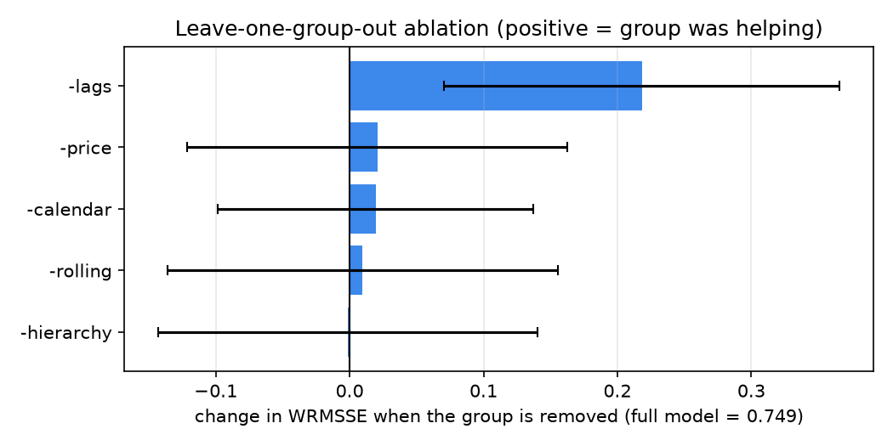

# Distribution-Free Probabilistic Demand Forecasting & Inventory Optimization

Retail demand forecasting where the output is a **prediction interval with measured, distribution-free
coverage**, and that interval feeds a **cost-optimal ordering decision** instead of being reported and
ignored.

<!-- results:start -->

_Generated by `scripts/make_report.py` from `results/`; data source: `synthetic`._

> **Result** — on the synthetic data (synthetic panel, 60 series), ordering the conformally calibrated quantile reduced simulated inventory cost by **18.4% (95% paired-bootstrap CI 17.2% to 19.7%)** versus ordering the mean forecast at a stockout/holding ratio of **4:1**, while CQR intervals held **90.3% empirical coverage** against a 90% nominal target (raw quantile model: 90.1%), across **5 walk-forward folds** and **60 series**.

### Forecast accuracy ladder

| model | WRMSSE | ± | MASE | ±  |
|---|---|---|---|---|
| croston | 1.038 | 0.135 | 1.177 | 0.111 |
| seasonal_naive | 1.015 | 0.150 | 1.196 | 0.122 |
| lgbm_point | 0.749 | 0.138 | 0.999 | 0.118 |

### Calibration


| nominal | method | coverage | width |
|---|---|---|---|
| 0.5 | CQR | 0.556 | 13.7 |
| 0.5 | raw quantile model | 0.318 | 13.7 |
| 0.5 | split conformal | 0.497 | 8.1 |
| 0.8 | CQR | 0.808 | 29.6 |
| 0.8 | raw quantile model | 0.806 | 29.5 |
| 0.8 | split conformal | 0.784 | 29.1 |
| 0.9 | CQR | 0.903 | 40.8 |
| 0.9 | raw quantile model | 0.901 | 40.8 |
| 0.9 | split conformal | 0.892 | 44.1 |
| 0.95 | CQR | 0.950 | 52.1 |
| 0.95 | raw quantile model | 0.946 | 51.8 |
| 0.95 | split conformal | 0.944 | 61.0 |

### Coverage by demand segment (nominal 90%)


| demand segment | method | coverage | width |
|---|---|---|---|
| intermittent | CQR | 0.966 | 3.8 |
| intermittent | raw quantile model | 0.961 | 3.8 |
| intermittent | split conformal | 1.000 | 27.3 |
| smooth | CQR | 0.880 | 30.7 |
| smooth | raw quantile model | 0.879 | 30.6 |
| smooth | split conformal | 0.980 | 52.7 |
| volatile | CQR | 0.863 | 88.0 |
| volatile | raw quantile model | 0.863 | 88.0 |
| volatile | split conformal | 0.696 | 52.3 |

### Decision layer: cost relative to the point policy


| p/h | quantile | conformal |
|---|---|---|
| 1.0 | 0.953 | 0.953 |
| 2.0 | 0.941 | 0.940 |
| 3.0 | 0.885 | 0.882 |
| 4.0 | 0.818 | 0.816 |
| 6.0 | 0.710 | 0.708 |
| 8.0 | 0.638 | 0.637 |
| 10.0 | 0.582 | 0.580 |

Paired bootstrap 95% CIs for the cost reduction vs the point policy at p/h = 4:

| policy | unit | n_pairs | reduction | lo | hi |
|---|---|---|---|---|---|
| raw quantile | fold | 5 | +18.2% | +17.1% | +19.5% |
| raw quantile | series | 300 | +18.1% | +15.6% | +20.5% |
| conformal | fold | 5 | +18.4% | +17.2% | +19.7% |
| conformal | series | 300 | +14.5% | +11.2% | +17.8% |

### Shift experiment: static CQR vs ACI


| scenario | method | coverage (post-onset) | width | cost @ p/h=4 | service level |
|---|---|---|---|---|---|
| level_down | ACI | 0.836 | 49.1 | 44,722 | 0.866 |
| level_down | CQR (static) | 0.690 | 40.6 | 45,397 | 0.903 |
| level_down | point policy |  |  | 42,922 | 0.795 |
| level_up | ACI | 0.819 | 69.8 | 92,751 | 0.684 |
| level_up | CQR (static) | 0.617 | 40.6 | 107,464 | 0.555 |
| level_up | point policy |  |  | 134,105 | 0.444 |
| none | ACI | 0.904 | 40.7 | 51,403 | 0.792 |
| none | CQR (static) | 0.904 | 40.6 | 51,422 | 0.787 |
| none | point policy |  |  | 63,014 | 0.586 |
| variance | ACI | 0.822 | 59.7 | 95,673 | 0.751 |
| variance | CQR (static) | 0.700 | 40.6 | 96,226 | 0.731 |
| variance | point policy |  |  | 109,260 | 0.610 |

### Feature-group ablation



| variant | WRMSSE | Δ vs full |
|---|---|---|
| -lags | 0.967 | +0.218 |
| -price | 0.770 | +0.021 |
| -calendar | 0.768 | +0.019 |
| -rolling | 0.759 | +0.010 |
| full | 0.749 | +0.000 |
| -hierarchy | 0.748 | -0.001 |

<!-- results:end -->

## Why intervals instead of point forecasts

Two things are wrong with forecasting a single number and ordering that much:

1. **A point forecast discards uncertainty.** Two SKUs both forecast at 100 units are not
   equivalent if one's plausible range is 95–105 and the other's is 20–300.
2. **The training loss is not the business loss.** Models are fit with MSE/MAE, which are
   symmetric. Real cost is not: unsold stock costs holding `h` per unit, a stockout costs lost
   margin `p`. When `p ≠ h`, ordering the *mean* is provably the wrong decision.

The newsvendor optimum is a **quantile** of the demand distribution, not its mean:

```
q* = F⁻¹( p / (p + h) )
```

At `p/h = 4` the cost-optimal order is the 80th percentile. A point forecast therefore
structurally under-orders whenever stockouts cost more than holding — and the gap widens with the
cost ratio. This project quantifies that gap, and shows that a *calibrated* quantile hits the
service level it aims at while the raw model quantile does not.

## Method

| Stage | Approach |
|---|---|
| Forecasting | Baseline ladder: seasonal naive → Croston → global LightGBM point (Tweedie) → multi-quantile LightGBM (pinball loss at 10 levels) |
| Uncertainty | Split conformal around the point forecast; **Conformalized Quantile Regression** (adaptive width) around the quantile model |
| Robustness | Controlled shift experiment on the test window, then **Adaptive Conformal Inference** |
| Decision | Newsvendor critical fractile; three ordering policies simulated across `p/h` ∈ [1, 10] |
| Evidence | 5 walk-forward folds with a dedicated calibration block, calibration curves, segment-conditional coverage, paired bootstrap CIs, leave-one-group-out ablation |

### Walk-forward protocol

```
|------------- train -------------|-- calib --|-- test --|     fold 0
|---------------- train ----------------|-- calib --|-- test --|     fold 1   (expanding)
```

The calibration block is mandatory and sits strictly between train and test in time. Early stopping
for the boosters uses a slice carved off the *end of train*, never the calibration block — selecting
a model against the calibration residuals would make them no longer the residuals of an unseen model.

### The two ordering policies that look alike and are not

- **Raw quantile policy** — order the quantile model's own prediction at `p/(p+h)`. Right idea, but
  nothing guarantees that the model's 80th percentile covers 80% of outcomes out of sample.
- **Conformal policy** — one-sided CQR at `p/(p+h)`: shift the raw quantile by the smallest constant
  that makes it cover the target fraction of the calibration block. The plot of realised service level
  against target fractile is the cleanest visual of what calibration buys.

### On what conformal prediction does and does not give you

Conformal prediction does **not** produce a calibrated predictive *distribution*. Split conformal
gives calibrated prediction *intervals* under exchangeability; CQR gives calibrated intervals built
around conditional quantile estimates. Time-series observations are not generally exchangeable, so
the vanilla finite-sample guarantee is not claimed to transfer unchanged — coverage is **measured**
on held-out test windows rather than assumed.

Adaptive Conformal Inference is not a repair for that. It provides *long-run time-averaged*
coverage: the empirical miscoverage frequency converges to α with no distributional assumptions. It
says nothing about coverage at an individual step, nothing about conditional coverage, and nothing
about interval **width** — width inflation is its known failure mode. Width is therefore reported
next to coverage everywhere in this repository, and ACI is only recommended where the shift
experiment shows it earning its cost.

## Data

M5 Forecasting — Accuracy (Walmart): 30,490 item×store series, 1,941 days, plus calendar (holidays,
events, SNAP days) and prices. Scoped to one store / top-N series by volume; the subset is recorded
in `configs/base.yaml` rather than left implicit.

A synthetic M5-like generator (`cfd.data.synth`) ships with the repo so the pipeline, tests, and
every experiment run with no download. It includes smooth, volatile, and intermittent regimes,
which is what the segment-conditional coverage analysis needs.

## Reproduce

```bash
uv sync --extra dev --extra app
make test        # leakage, split, metric, conformal, decision tests
make all         # data -> baselines -> gbm -> conformal -> decision -> ablation -> shift -> report
make app         # Streamlit page over results/ and reports/
```

`make all` runs on the synthetic panel by default. To switch to real M5, accept the competition rules
on Kaggle, place `calendar.csv`, `sell_prices.csv`, and `sales_train_evaluation.csv` in `data/raw/`,
set `data.source: m5` in `configs/base.yaml`, and run `make all` again — every table, figure, and the
results block above are regenerated from `results/`.

Each stage is also a script under `scripts/`, in the order the Makefile runs them. Reproducibility is
YAML in git plus a config hash on every row of the append-only `results/results.parquet` — no
tracking server.

## The two invariants that are enforced, not asserted

**Causality.** Every feature at time *t* is computable from data strictly before *t*. Rolling
statistics are shift-then-roll, never roll-then-shift. `tests/test_no_leakage.py` corrupts every
future target and checks that no past feature moves.

**Origin safety.** Causality is necessary but not sufficient: a 28-day-ahead forecast made at origin
*T* may only use observations up to *T*, so `y_lag_1` is illegal at test day 2 even though it is
causal. All target-derived features are shifted by `origin_shift == horizon` and `build_features`
refuses a lag shorter than the horizon. The same test file perturbs only the forecast window and
asserts that nothing the model sees changes.

```bash
uv run pytest tests/test_no_leakage.py -v
```

## Layout

```
src/cfd/
├── config.py               # YAML config + stable run hash
├── data/
│   ├── synth.py            # synthetic M5-like panel (3 demand regimes)
│   ├── ingest.py           # raw -> PANEL_SCHEMA long format
│   └── features.py         # named feature groups; origin-safe lags; segment labels
├── splits.py               # walk-forward train | calib | test
├── pipeline.py             # fit one fold, write calib + test predictions
├── models/
│   ├── baselines.py        # seasonal naive, Croston (SBA)
│   └── gbm.py              # global LightGBM point + multi-quantile boosters
├── conformal/
│   ├── split.py            # split conformal; order-statistic quantile with the (n+1) correction
│   ├── cqr.py              # CQR, two-sided and one-sided
│   └── adaptive.py         # ACI with the guarantee stated precisely
├── decision/
│   ├── newsvendor.py       # critical fractile, quantile-function interpolation, cost
│   └── simulate.py         # point / raw-quantile / conformal policies over a p/h sweep
└── eval/
    ├── metrics.py          # MASE, RMSSE, WRMSSE, pinball, coverage, paired bootstrap
    ├── scoring.py          # one scorer for every rung of the ladder
    └── track.py            # append-only results.parquet keyed by config hash
scripts/                    # one script per stage; make_report.py owns the README block
app/streamlit_app.py        # results + a per-series explorer with a p/h slider
reports/{figures,tables}/   # generated; committed so the README renders on GitHub
```

## Things worth knowing before quoting the numbers

- **Fold-level vs series-level CIs differ, and both are reported.** The fold-level statistic is the
  reduction in *total* cost, so high-volume series dominate it. The series-level statistic averages
  each series' own relative reduction, so a low-volume series counts as much as a high-volume one.
- **Coverage on a discrete, zero-heavy target is conservative, not exact.** Many realised values are
  0 and the interval's lower edge is floored at 0, so ties make a nominal 50% interval cover more than
  50%. This is a property of the data, not a bug in the method, and it is why the calibration curve
  is read at 80–95%.
- **The ACI experiment assumes one-day feedback.** A real 28-day-ahead system learns a day's outcome
  up to 28 days after forecasting it; `conformal.aci.feedback_lag` controls this and 1 is the
  optimistic end. The 28-day test windows are also short relative to the long-run guarantee, so the
  shift results show *direction and cost*, not a converged frequency.
- **Where the raw quantile model is already well calibrated, CQR's shift is ≈ 0 and the two curves
  overlap.** That is the correct outcome, not a failure: the calibration step is insurance whose
  payout shows up when the model is wrong — see the shift experiment and the service-level plot.
- **Intermittent series are covered but not informatively.** Their intervals are a few units wide
  around zero; coverage is satisfied while the forecast carries little decision value. Croston-style
  handling and the Tweedie objective keep them from wrecking the metrics; they do not make them
  forecastable.

## References

- Angelopoulos & Bates, *A Gentle Introduction to Conformal Prediction and Distribution-Free
  Uncertainty Quantification*
- Romano, Patterson & Candès, *Conformalized Quantile Regression* (NeurIPS 2019)
- Gibbs & Candès, *Adaptive Conformal Inference Under Distribution Shift* (NeurIPS 2021)
- Xu & Xie, *Conformal Prediction Interval for Dynamic Time-Series* (ICML 2021)
- Ban & Rudin, *The Big Data Newsvendor: Practical Insights from Machine Learning*
  (Operations Research 2019)
- Bertsimas & Kallus, *From Predictive to Prescriptive Analytics* (Management Science 2020)
- Makridakis, Spiliotis & Assimakopoulos, *The M5 competition: Background, organization, and
  implementation* (IJF 2022)
